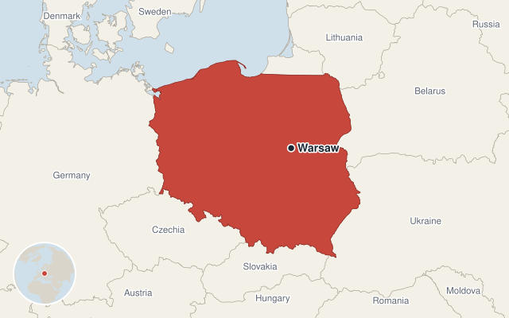

---
id    = "d70723c1-136d-53c3-92fc-02e586b318db"
model = "Basic"
tags  = ["europe", "european_union", "sovereign_state", "capital"]
---

## Front

What is the capital of <b>Poland</b>?

## Back

<b>Warsaw</b>

## Extra

<a href="https://en.wikipedia.org/wiki/Warsaw">Warsaw on Wikipedia</a> <a href="https://en.wikipedia.org/wiki/Poland">Poland on Wikipedia</a>
