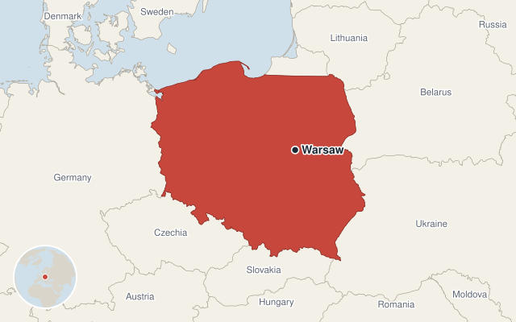

---
id    = "1bb992c9-9e64-5fa7-afbd-ba8cc71143e7"
model = "Basic"
tags  = ["europe", "european_union", "sovereign_state", "country"]
---

## Front

<b>Warsaw</b> is the capital of which country or territory?

## Back

<b>Poland</b>

## Extra

<a href="https://en.wikipedia.org/wiki/Poland">Poland on Wikipedia</a> <a href="https://en.wikipedia.org/wiki/Warsaw">Warsaw on Wikipedia</a>
