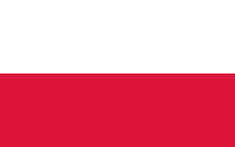

---
id    = "190def47-8016-5e8f-b280-c6cae057edb5"
model = "Basic"
tags  = ["europe", "european_union", "sovereign_state", "flag"]
---

## Front

Whose flag is this?

## Back

<b>Poland</b>

## Extra

Similar flags: Indonesia (white and red flipped, brighter red), Monaco (white and red flipped, narrower)
