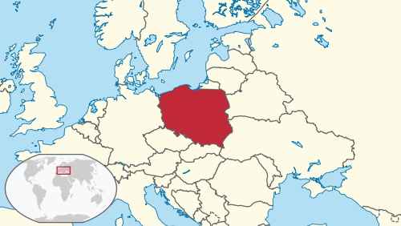
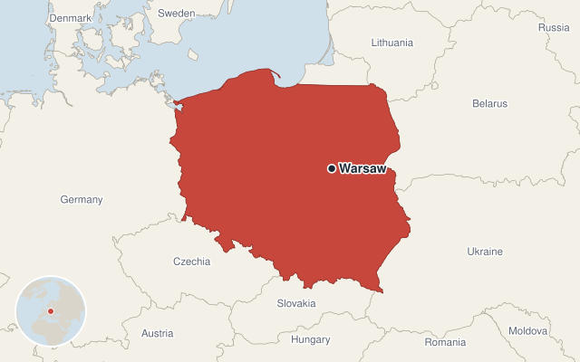

---
id    = "ef39d3ac-8cbd-521a-9032-ac306c969867"
model = "Basic"
tags  = ["europe", "european_union", "sovereign_state", "map"]
---

## Front

What is highlighted on this map?

## Back

<b>Poland</b>

## Extra

<a href="https://en.wikipedia.org/wiki/Poland">Poland on Wikipedia</a>
