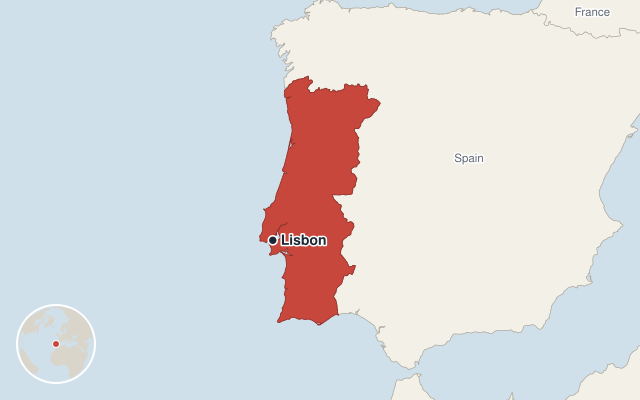

---
id    = "ecdb8abe-f82f-5343-9faa-ab050ec123df"
model = "Basic"
tags  = ["europe", "european_union", "sovereign_state", "capital"]
---

## Front

What is the capital of <b>Portugal</b>?

## Back

<b>Lisbon</b>

## Extra

About 546,000 people (2021) in the city; 3.35 million in the metropolitan area On the northern shore of the River Tagus

The second-oldest European capital after Athens. It became Portugal's capital in 1255, replacing Coimbra, after Afonso Henriques conquered it in 1147.

<a href="https://en.wikipedia.org/wiki/Lisbon">Lisbon on Wikipedia</a> <a href="https://en.wikipedia.org/wiki/Portugal">Portugal on Wikipedia</a>
