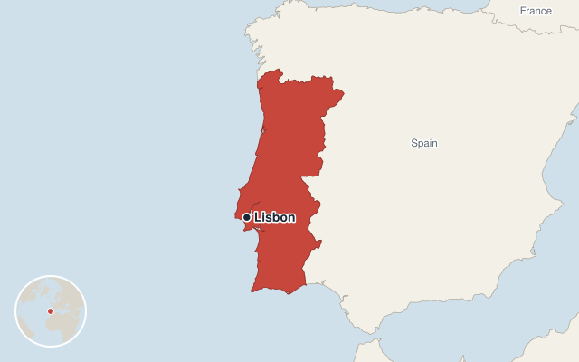

---
id    = "7ccef1f5-179f-5622-9d57-adb7ea85332f"
model = "Basic"
tags  = ["europe", "european_union", "sovereign_state", "country"]
---

## Front

<b>Lisbon</b> is the capital of which country or territory?

## Back

<b>Portugal</b>

## Extra

About 10.3 million people (2021) in 92,225 km² Includes the Atlantic archipelagos of Madeira and the Azores

A kingdom since 1179, it built the Portuguese Empire during the Age of Discovery. It became a republic in 1910, and democracy was established in 1976 after the 1974 overthrow of a dictatorship.

<a href="https://en.wikipedia.org/wiki/Portugal">Portugal on Wikipedia</a> <a href="https://en.wikipedia.org/wiki/Lisbon">Lisbon on Wikipedia</a>
