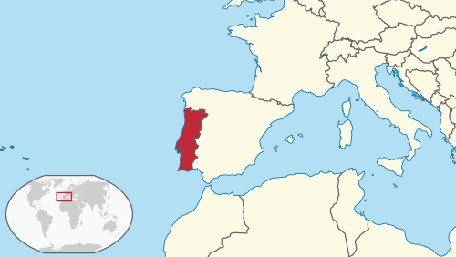
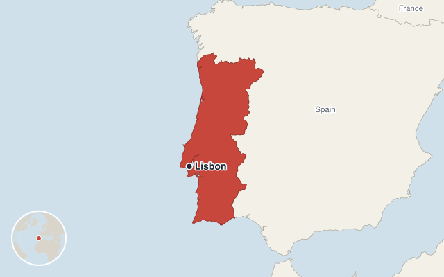

---
id    = "6302cd9d-b0f3-5d04-9b49-d43595a4a593"
model = "Basic"
tags  = ["europe", "european_union", "sovereign_state", "map"]
---

## Front

What is highlighted on this map?

## Back

<b>Portugal</b>

## Extra

<a href="https://en.wikipedia.org/wiki/Portugal">Portugal on Wikipedia</a>
