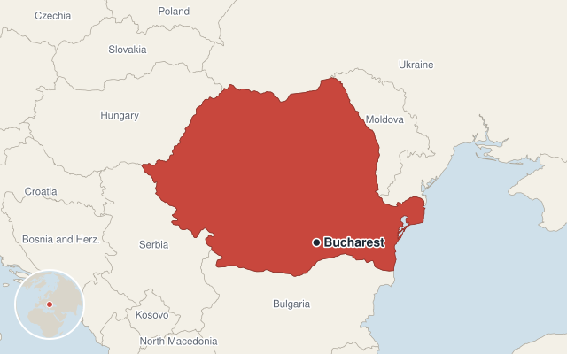

---
id    = "6a804306-8b52-5a77-9e0f-2facaa6ef1c0"
model = "Basic"
tags  = ["europe", "european_union", "sovereign_state", "capital"]
---

## Front

What is the capital of <b>Romania</b>?

## Back

<b>Bucharest</b>

## Extra

About 1.7 million people (2021) in the city proper On the River Dâmbovița, in south-eastern Romania

Nicknamed the "Paris of the East" for its cosmopolitan life and eclectic architecture. It was first mentioned in 1459 and became capital of the Romanian United Principalities in 1862.

<a href="https://en.wikipedia.org/wiki/Bucharest">Bucharest on Wikipedia</a> <a href="https://en.wikipedia.org/wiki/Romania">Romania on Wikipedia</a>
