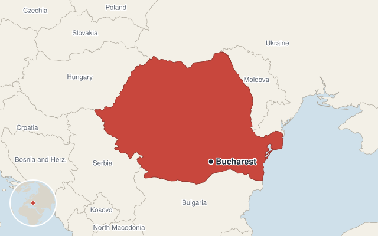

---
id    = "5a4fe32b-47ce-5e93-a5de-012590dcb26c"
model = "Basic"
tags  = ["europe", "european_union", "sovereign_state", "country"]
---

## Front

<b>Bucharest</b> is the capital of which country or territory?

## Back

<b>Romania</b>

## Extra

<a href="https://en.wikipedia.org/wiki/Romania">Romania on Wikipedia</a> <a href="https://en.wikipedia.org/wiki/Bucharest">Bucharest on Wikipedia</a>
