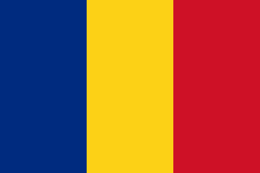

---
id    = "e5e394ac-a44e-5be7-ba41-1528619a1cdd"
model = "Basic"
tags  = ["europe", "european_union", "sovereign_state", "flag"]
---

## Front

Whose flag is this?

## Back

<b>Romania</b>

## Extra

Similar flags: Chad (slightly darker blue)
