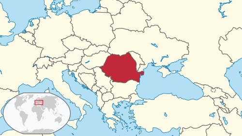

---
id    = "8213a8b9-1187-5547-ab1a-1888f7c62f42"
model = "Basic"
tags  = ["europe", "european_union", "sovereign_state", "map"]
---

## Front

What is highlighted on this map?

## Back

<b>Romania</b>
