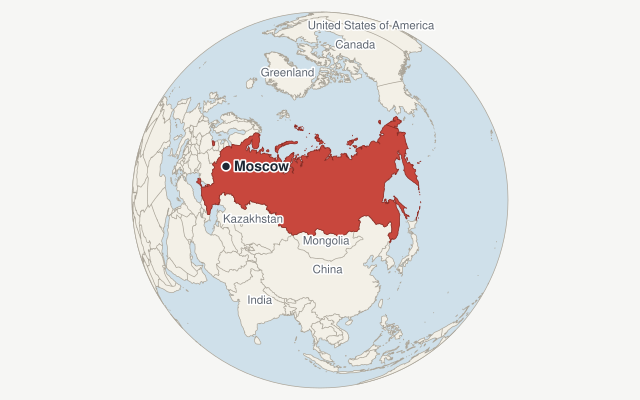

---
id    = "dc9c3889-5721-579f-9bd1-551b460a503b"
model = "Basic"
tags  = ["europe", "sovereign_state", "capital"]
---

## Front

What is the capital of <b>Russia</b>?

## Back

<b>Moscow</b>

## Extra

About 13 million people (2025) in the city On the Moskva River, in Central Russia

First documented in 1147. Peter the Great moved the capital to Saint Petersburg in 1712, and it returned to Moscow in 1918 after the Russian Revolution.

<a href="https://en.wikipedia.org/wiki/Moscow">Moscow on Wikipedia</a> <a href="https://en.wikipedia.org/wiki/Russia">Russia on Wikipedia</a>
