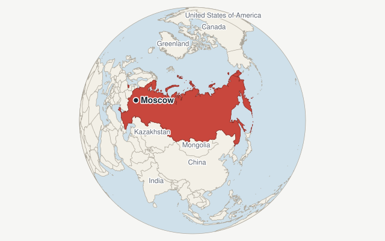

---
id    = "58bf8b36-b1ba-5697-a559-2c2ed493cd46"
model = "Basic"
tags  = ["europe", "sovereign_state", "country"]
---

## Front

<b>Moscow</b> is the capital of which country or territory?

## Back

<b>Russia</b>

## Extra

<a href="https://en.wikipedia.org/wiki/Russia">Russia on Wikipedia</a> <a href="https://en.wikipedia.org/wiki/Moscow">Moscow on Wikipedia</a>
