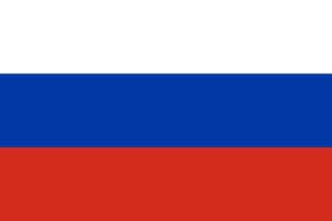
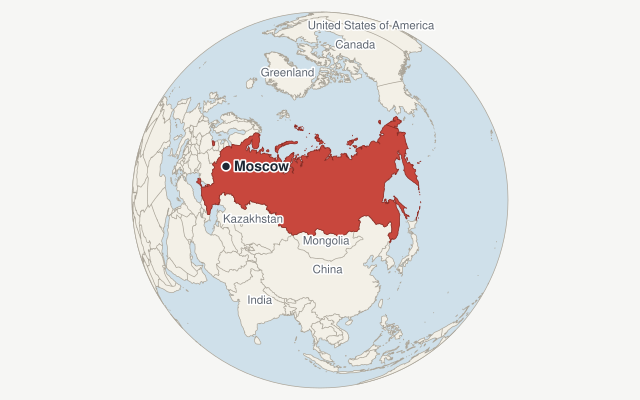

---
id    = "1af844ae-a106-56cd-ba0c-d88ab5ed3992"
model = "Basic"
tags  = ["europe", "sovereign_state", "flag"]
---

## Front

Whose flag is this?

## Back

<b>Russia</b>

## Extra

Introduced under Peter the Great in 1693; the current proportions were set in 1993

White, blue and red. It was a civil ensign from 1705, was banned by the Bolsheviks in 1917, and was restored as the national flag after the August Coup of 1991.

Similar flags: Slovakia (with coat of arms)

<a href="https://en.wikipedia.org/wiki/Flag_of_Russia">Flag of Russia on Wikipedia</a> <a href="https://en.wikipedia.org/wiki/Russia">Russia on Wikipedia</a>
