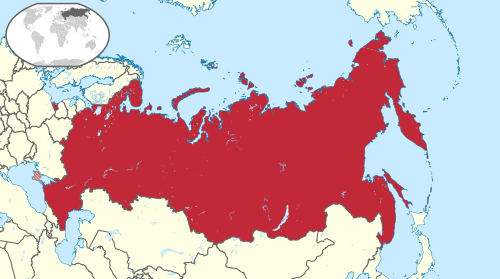
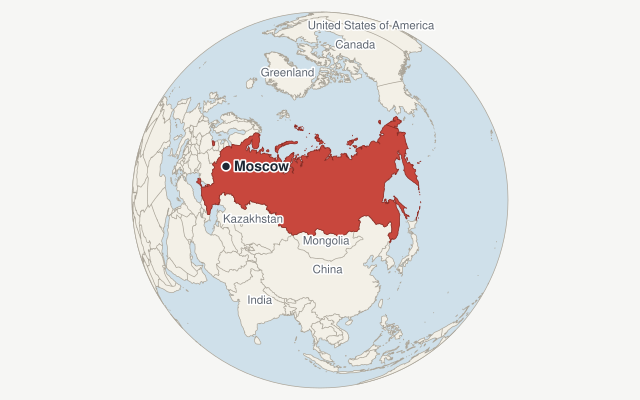

---
id    = "d92ecc80-8ea4-5e61-b78b-4ff632c96d99"
model = "Basic"
tags  = ["europe", "sovereign_state", "map"]
---

## Front

What is highlighted on this map?

## Back

<b>Russia</b>

## Extra

<a href="https://en.wikipedia.org/wiki/Russia">Russia on Wikipedia</a>
