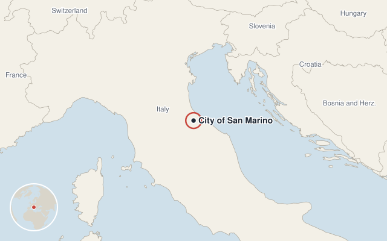

---
id    = "d19b8b4a-0f24-5a79-9d0c-06aee9e8f894"
model = "Basic"
tags  = ["europe", "sovereign_state", "capital"]
---

## Front

What is the capital of <b>San Marino</b>?

## Back

<b>City of San Marino</b>

## Extra

<a href="https://en.wikipedia.org/wiki/City_of_San_Marino">City of San Marino on Wikipedia</a> <a href="https://en.wikipedia.org/wiki/San_Marino">San Marino on Wikipedia</a>
