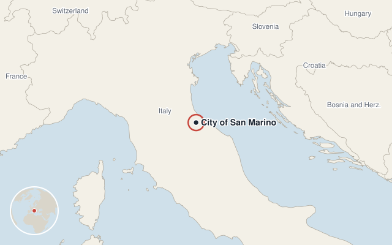

---
id    = "4b047a16-70c2-5684-96bc-f2820c90b64f"
model = "Basic"
tags  = ["europe", "sovereign_state", "country"]
---

## Front

<b>City of San Marino</b> is the capital of which country or territory?

## Back

<b>San Marino</b>

## Extra

<a href="https://en.wikipedia.org/wiki/San_Marino">San Marino on Wikipedia</a> <a href="https://en.wikipedia.org/wiki/City_of_San_Marino">City of San Marino on Wikipedia</a>
