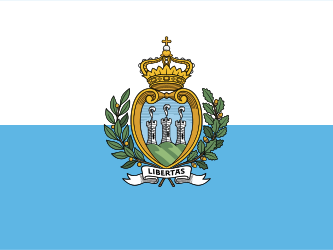
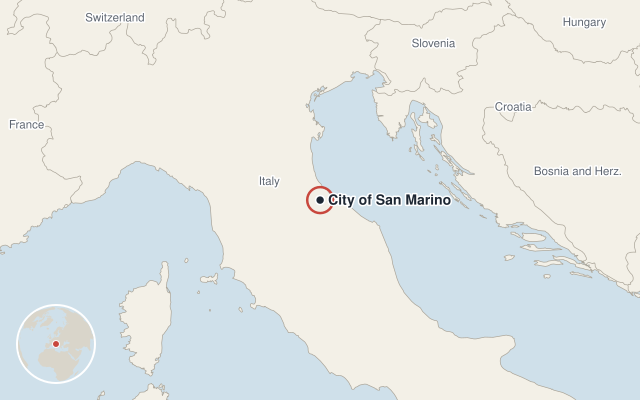

---
id    = "3a3ba25b-f7a9-58c9-a6c5-a9e32b354730"
model = "Basic"
tags  = ["europe", "sovereign_state", "flag"]
---

## Front

Whose flag is this?

## Back

<b>San Marino</b>

## Extra

<a href="https://en.wikipedia.org/wiki/Flag_of_San_Marino">Flag of San Marino on Wikipedia</a> <a href="https://en.wikipedia.org/wiki/San_Marino">San Marino on Wikipedia</a>
