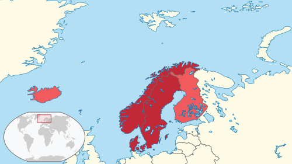

---
id    = "51418952-226b-5458-95de-471890473678"
model = "Basic"
tags  = ["europe", "map"]
---

## Front

What is highlighted on this map?

## Back

<b>Scandinavia</b>

## Extra

Most commonly Denmark, Norway and Sweden

Fjords in the west of Norway and mountains across Norway and Sweden give way to the low, flat land of Denmark in the south.

Historical and cultural region in Northern Europe, which includes the countries of Denmark, Norway and Sweden, and sometimes Finland and Iceland.

<a href="https://en.wikipedia.org/wiki/Scandinavia">Scandinavia on Wikipedia</a>
