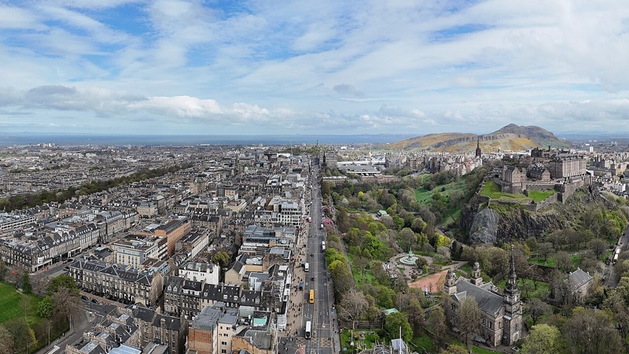

---
id    = "1ff68368-9ef0-59fb-a17e-5254ffaf1055"
model = "Basic"
tags  = ["europe", "capital"]
---

## Front

What is the capital of <b>Scotland</b>?

## Back

<b>Edinburgh</b>

## Extra

<i>Photo: 瑞丽江的河水, CC BY-SA 4.0, via Wikimedia Commons</i>

About 506,000 people (2020), the second most populous city in Scotland Between the Firth of Forth and the Pentland Hills

The Fringe, held here every year, is the world's largest annual international arts festival. Edinburgh has been recognised as the capital of Scotland since at least the 15th century.

Constituent country of the United Kingdom.

<a href="https://en.wikipedia.org/wiki/Edinburgh">Edinburgh on Wikipedia</a> <a href="https://en.wikipedia.org/wiki/Scotland">Scotland on Wikipedia</a>
