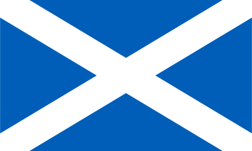

---
id    = "a4c76d1e-d775-5692-af0d-eed58bee922c"
model = "Basic"
tags  = ["europe", "flag"]
---

## Front

Whose flag is this?

## Back

<b>Scotland</b>

## Extra

Constituent country of the United Kingdom.

<a href="https://en.wikipedia.org/wiki/Flag_of_Scotland">Flag of Scotland on Wikipedia</a> <a href="https://en.wikipedia.org/wiki/Scotland">Scotland on Wikipedia</a>
