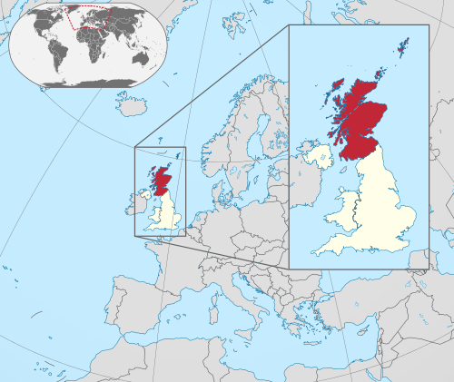
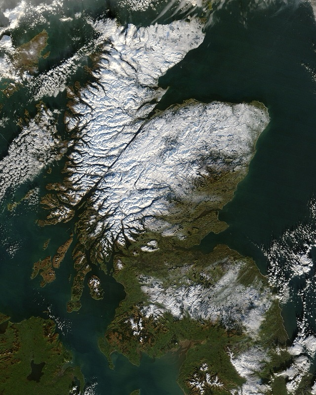

---
id    = "9974d969-60bc-5b70-a30a-a4636ede23c9"
model = "Basic"
tags  = ["europe", "map"]
---

## Front

What is highlighted on this map?

## Back

<b>Scotland</b>

## Extra

<i>Photo: NASA; Uploaded by User:MaiDireLollo, Public domain, via Wikimedia Commons</i>

Borders England to the south The northern part of Great Britain, plus the Hebrides and the Northern Isles

It meets the Atlantic Ocean to the north and west, the North Sea to the east and the Irish Sea to the south-west.

Constituent country of the United Kingdom.

<a href="https://en.wikipedia.org/wiki/Scotland">Scotland on Wikipedia</a>
