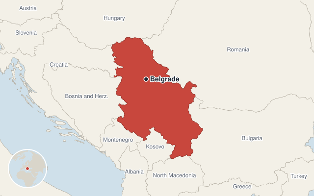

---
id    = "1e28b106-17d1-5805-aff3-1a3385521f23"
model = "Basic"
tags  = ["europe", "sovereign_state", "capital"]
---

## Front

What is the capital of <b>Serbia</b>?

## Back

<b>Belgrade</b>

## Extra

<a href="https://en.wikipedia.org/wiki/Belgrade">Belgrade on Wikipedia</a> <a href="https://en.wikipedia.org/wiki/Serbia">Serbia on Wikipedia</a>
