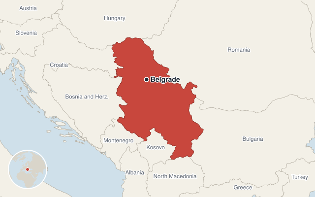

---
id    = "d7653e90-391c-530c-b50b-e61838f3cf42"
model = "Basic"
tags  = ["europe", "sovereign_state", "country"]
---

## Front

<b>Belgrade</b> is the capital of which country or territory?

## Back

<b>Serbia</b>

## Extra

<a href="https://en.wikipedia.org/wiki/Serbia">Serbia on Wikipedia</a> <a href="https://en.wikipedia.org/wiki/Belgrade">Belgrade on Wikipedia</a>
