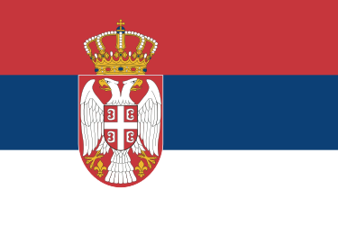
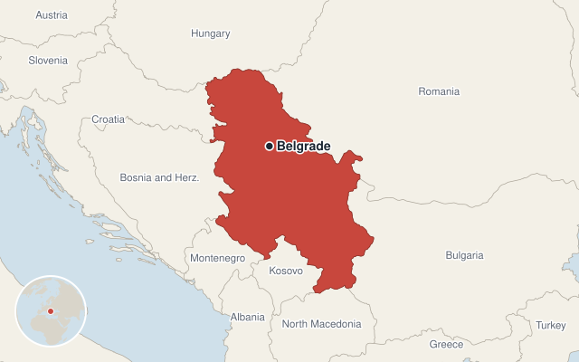

---
id    = "be31164d-2398-5e34-894d-0ac93a31de7c"
model = "Basic"
tags  = ["europe", "sovereign_state", "flag"]
---

## Front

Whose flag is this?

## Back

<b>Serbia</b>

## Extra

Current form adopted in 2004, slightly redesigned in 2010

Red, blue and white bands, called the Tricolour. The same colours have been used in varying forms as the flag of Serbia since 1839.

<a href="https://en.wikipedia.org/wiki/Flag_of_Serbia">Flag of Serbia on Wikipedia</a> <a href="https://en.wikipedia.org/wiki/Serbia">Serbia on Wikipedia</a>
