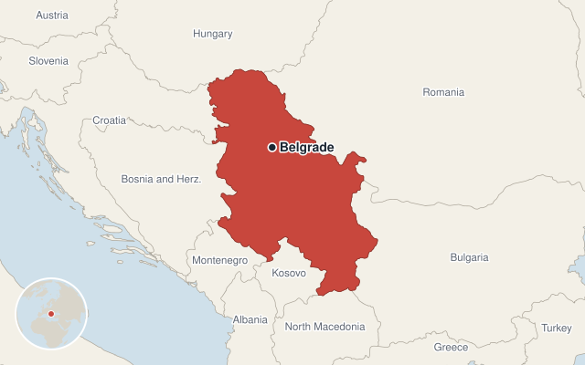

---
id    = "a941cab1-e96e-54c9-b2de-024b7dae9ca1"
model = "Basic"
tags  = ["europe", "sovereign_state", "map"]
---

## Front

What is highlighted on this map?

## Back

<b>Serbia</b>

## Extra

Borders Hungary, Romania, Bulgaria, North Macedonia, Montenegro, Bosnia and Herzegovina and Croatia Highest point: Velika Rudoka

Serbia is landlocked, in Southeastern and Central Europe.

<a href="https://en.wikipedia.org/wiki/Serbia">Serbia on Wikipedia</a>
