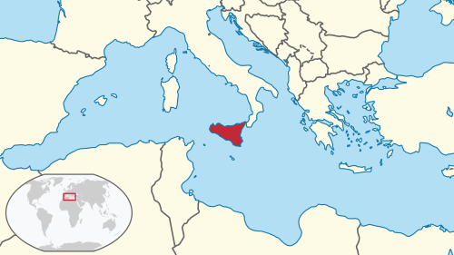

---
id    = "69fe251d-de5e-530c-af99-2d84ab9ce3e1"
model = "Basic"
tags  = ["europe", "map"]
---

## Front

What is highlighted on this map?

## Back

<b>Sicily</b>

## Extra

About 5 million people (2019) in 25,711 km² Separated from Calabria by the Strait of Messina

The largest and most populous island in the Mediterranean Sea. Mount Etna, the tallest active volcano in Europe, is its most prominent landmark.

Autonomous region of Italy.

<a href="https://en.wikipedia.org/wiki/Sicily">Sicily on Wikipedia</a>
