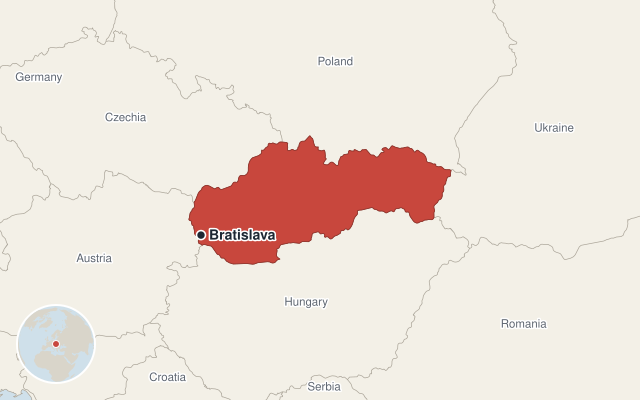
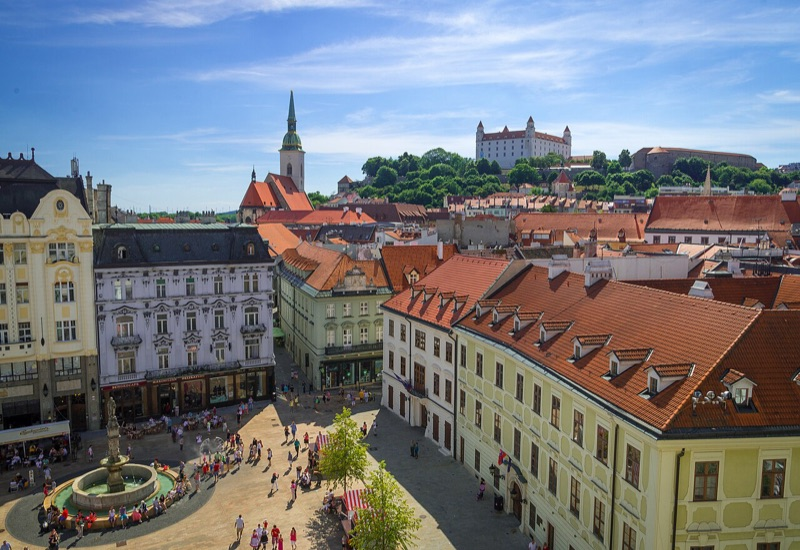

---
id    = "5ac7ed92-5b4c-51ab-aca7-f854cc460d1f"
model = "Basic"
tags  = ["europe", "european_union", "sovereign_state", "capital"]
---

## Front

What is the capital of <b>Slovakia</b>?

## Back

<b>Bratislava</b>

## Extra

<i>Photo: Rob Hurson from Kentstown, Ireland, CC BY-SA 2.0, via Wikimedia Commons</i>

About 481,000 people (2025) On both banks of the Danube, at the foot of the Little Carpathians

The only national capital to have land borders with two other sovereign states, Austria and Hungary. Vienna is just 50 km away, the closest pair of capitals in Europe.

<a href="https://en.wikipedia.org/wiki/Bratislava">Bratislava on Wikipedia</a> <a href="https://en.wikipedia.org/wiki/Slovakia">Slovakia on Wikipedia</a>
