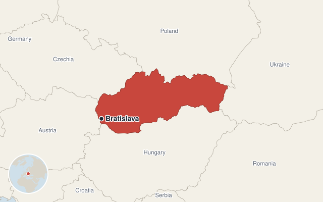

---
id    = "dcd5c6f3-5f1e-5d55-a027-f5aeafb89551"
model = "Basic"
tags  = ["europe", "european_union", "sovereign_state", "country"]
---

## Front

<b>Bratislava</b> is the capital of which country or territory?

## Back

<b>Slovakia</b>

## Extra

<a href="https://en.wikipedia.org/wiki/Slovakia">Slovakia on Wikipedia</a> <a href="https://en.wikipedia.org/wiki/Bratislava">Bratislava on Wikipedia</a>
