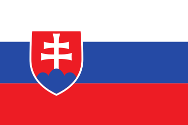

---
id    = "52635661-2c84-597a-be44-709b0cca0f85"
model = "Basic"
tags  = ["europe", "european_union", "sovereign_state", "flag"]
---

## Front

Whose flag is this?

## Back

<b>Slovakia</b>

## Extra

Similar flags: Russia (no coat of arms), Slovenia (wider, smaller coat of arms)
