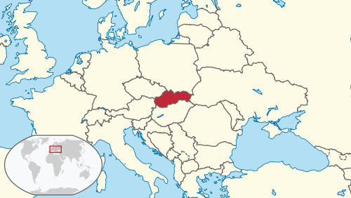
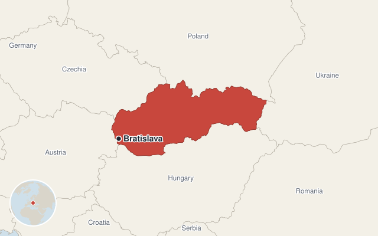

---
id    = "659cc9cb-a6f1-535d-b259-6ede043bbb6e"
model = "Basic"
tags  = ["europe", "european_union", "sovereign_state", "map"]
---

## Front

What is highlighted on this map?

## Back

<b>Slovakia</b>

## Extra

Borders Poland, Ukraine, Hungary, Austria and the Czech Republic Highest point: Gerlachovský štít

Landlocked in Central Europe, with a mostly mountainous territory.

<a href="https://en.wikipedia.org/wiki/Slovakia">Slovakia on Wikipedia</a>
