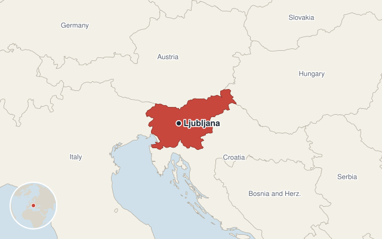

---
id    = "9fb94688-29a2-5093-bca7-8b8c1ed1a9bc"
model = "Basic"
tags  = ["europe", "european_union", "mediterranean", "sovereign_state", "capital"]
---

## Front

What is the capital of <b>Slovenia</b>?

## Back

<b>Ljubljana</b>

## Extra

<a href="https://en.wikipedia.org/wiki/Ljubljana">Ljubljana on Wikipedia</a> <a href="https://en.wikipedia.org/wiki/Slovenia">Slovenia on Wikipedia</a>
