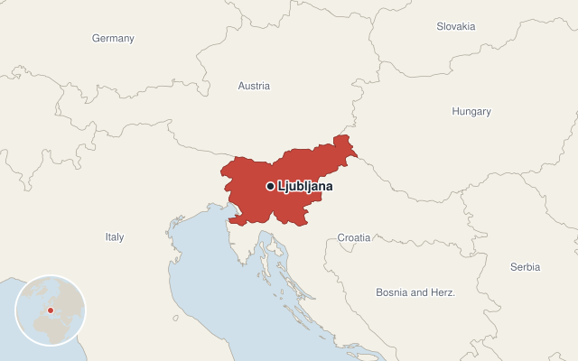

---
id    = "2cbd06b9-47ad-5449-9b33-cd8eb29eadee"
model = "Basic"
tags  = ["europe", "european_union", "mediterranean", "sovereign_state", "country"]
---

## Front

<b>Ljubljana</b> is the capital of which country or territory?

## Back

<b>Slovenia</b>

## Extra

<a href="https://en.wikipedia.org/wiki/Slovenia">Slovenia on Wikipedia</a> <a href="https://en.wikipedia.org/wiki/Ljubljana">Ljubljana on Wikipedia</a>
