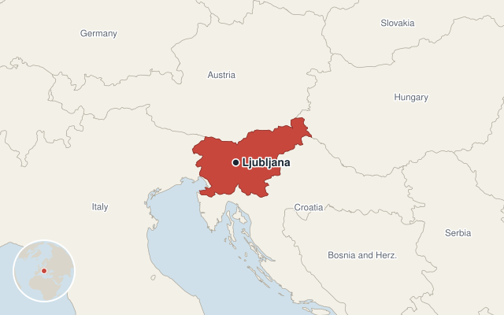

---
id    = "dde84063-947f-57c1-9cf5-6a15836e6415"
model = "Basic"
tags  = ["europe", "european_union", "mediterranean", "sovereign_state", "flag"]
---

## Front

Whose flag is this?

## Back

<b>Slovenia</b>

## Extra

Similar flags: Slovakia (narrower, bigger coat of arms)

<a href="https://en.wikipedia.org/wiki/Flag_of_Slovenia">Flag of Slovenia on Wikipedia</a> <a href="https://en.wikipedia.org/wiki/Slovenia">Slovenia on Wikipedia</a>
