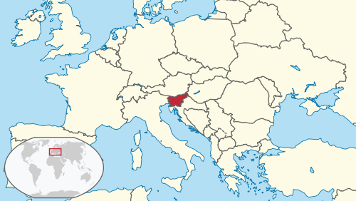

---
id    = "90f1cbea-47ab-5a3c-ad63-3d6211737dd0"
model = "Basic"
tags  = ["europe", "european_union", "mediterranean", "sovereign_state", "map"]
---

## Front

What is highlighted on this map?

## Back

<b>Slovenia</b>
