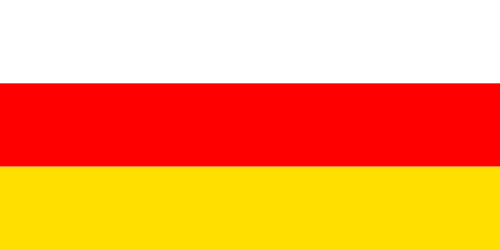

---
id    = "912200fc-6c75-5758-a5fc-9a8a6e9df00d"
model = "Basic"
tags  = ["europe", "sovereign_state", "flag"]
---

## Front

Whose flag is this?

## Back

<b>South Ossetia</b>

## Extra

Independent state claimed by Georgia.

<a href="https://en.wikipedia.org/wiki/Flag_of_Ossetia">Flag of Ossetia on Wikipedia</a> <a href="https://en.wikipedia.org/wiki/South_Ossetia">South Ossetia on Wikipedia</a>
