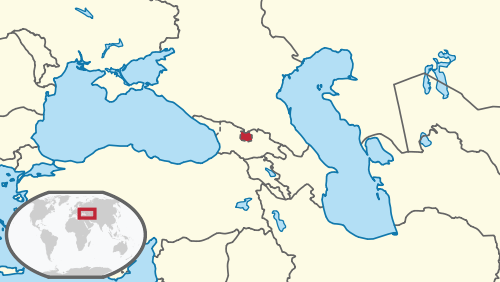

---
id    = "8d1e04df-0bd7-54cd-a912-c76c52031d80"
model = "Basic"
tags  = ["europe", "sovereign_state", "map"]
---

## Front

What is highlighted on this map?

## Back

<b>South Ossetia</b>

## Extra

De facto borders only Russia and Georgia Highest point: Chanchakhi

Independent state claimed by Georgia.

<a href="https://en.wikipedia.org/wiki/South_Ossetia">South Ossetia on Wikipedia</a>
