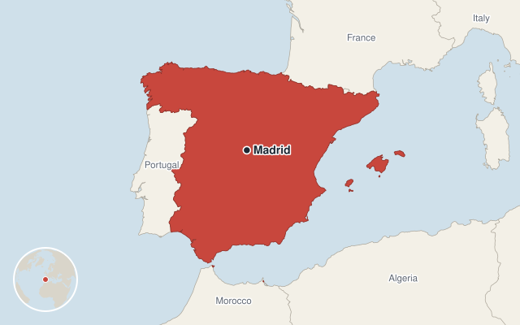
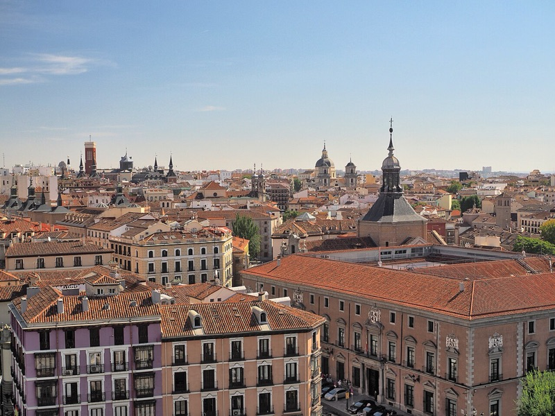

---
id    = "b163d2d8-6393-5b85-9e97-b26bfcdc868e"
model = "Basic"
tags  = ["europe", "european_union", "mediterranean", "sovereign_state", "capital"]
---

## Front

What is the capital of <b>Spain</b>?

## Back

<b>Madrid</b>

## Extra

<i>Photo: Dmitry Dzhus from London, CC BY 2.0, via Wikimedia Commons</i>

About 3.5 million people (2025) in the city proper About 660 m above sea level, on the River Manzanares

It began as a walled military outpost in the late 9th century and became the permanent seat of the court in 1561. It is the second-largest city in the European Union, after Berlin.

<a href="https://en.wikipedia.org/wiki/Madrid">Madrid on Wikipedia</a> <a href="https://en.wikipedia.org/wiki/Spain">Spain on Wikipedia</a>
