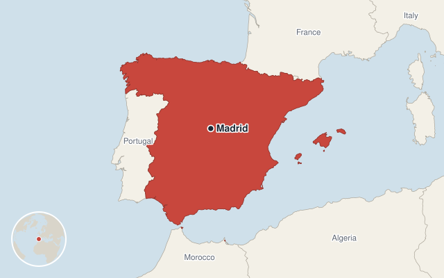

---
id    = "2defe75a-586f-589d-9df1-17f12ce1afdb"
model = "Basic"
tags  = ["europe", "european_union", "mediterranean", "sovereign_state", "country"]
---

## Front

<b>Madrid</b> is the capital of which country or territory?

## Back

<b>Spain</b>

## Extra

<a href="https://en.wikipedia.org/wiki/Spain">Spain on Wikipedia</a> <a href="https://en.wikipedia.org/wiki/Madrid">Madrid on Wikipedia</a>
