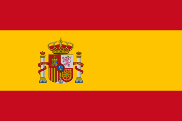
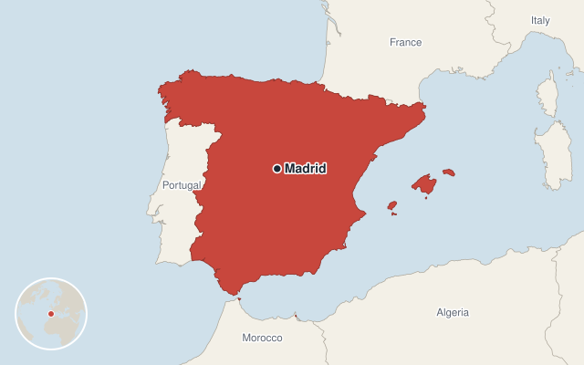

---
id    = "25e9610e-850d-5aac-a676-36c9e2006099"
model = "Basic"
tags  = ["europe", "european_union", "mediterranean", "sovereign_state", "flag"]
---

## Front

Whose flag is this?

## Back

<b>Spain</b>

## Extra

Origin: the naval ensign of 1785

Red-yellow-red, with the yellow stripe twice as tall as each red one. Charles III chose it from 12 designs by Antonio Valdés y Bazán, and it stayed mainly a naval flag for about 50 years.

<a href="https://en.wikipedia.org/wiki/Flag_of_Spain">Flag of Spain on Wikipedia</a> <a href="https://en.wikipedia.org/wiki/Spain">Spain on Wikipedia</a>
