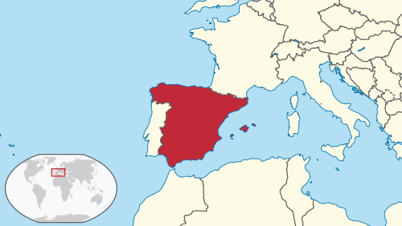

---
id    = "350d3478-72cf-5528-addd-63d060a785b9"
model = "Basic"
tags  = ["europe", "european_union", "mediterranean", "sovereign_state", "map"]
---

## Front

What is highlighted on this map?

## Back

<b>Spain</b>
