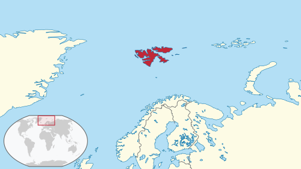
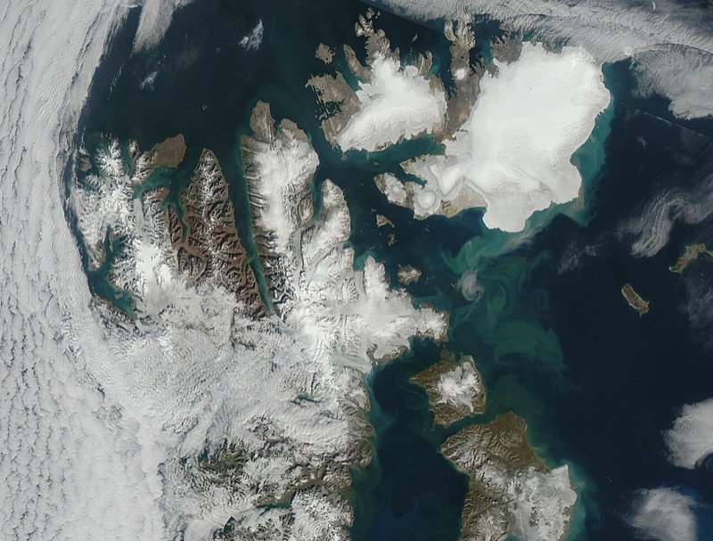

---
id    = "915de06d-3df9-59c4-88e3-3d1e9c9041b1"
model = "Basic"
tags  = ["europe", "map"]
---

## Front

What is highlighted on this map?

## Back

<b>Svalbard</b>

## Extra

<i>Photo: MODIS Land Rapid Response Team, NASA GSFC, Public domain, via Wikimedia Commons</i>

Archipelago of 61,022 km², about midway between Norway and the North Pole Highest point: Newtontoppen

The islands lie between 74° and 81° north. The largest island is Spitsbergen, at 37,673 km², and the largest settlement is Longyearbyen.

Unincorporated internal area of Norway.

<a href="https://en.wikipedia.org/wiki/Svalbard">Svalbard on Wikipedia</a>
