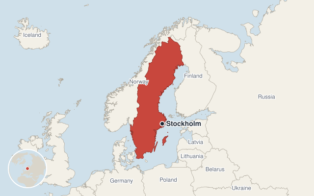

---
id    = "cbd37399-7946-5a54-b950-c53a2d1ca479"
model = "Basic"
tags  = ["europe", "european_union", "sovereign_state", "capital"]
---

## Front

What is the capital of <b>Sweden</b>?

## Back

<b>Stockholm</b>

## Extra

<a href="https://en.wikipedia.org/wiki/Stockholm">Stockholm on Wikipedia</a> <a href="https://en.wikipedia.org/wiki/Sweden">Sweden on Wikipedia</a>
