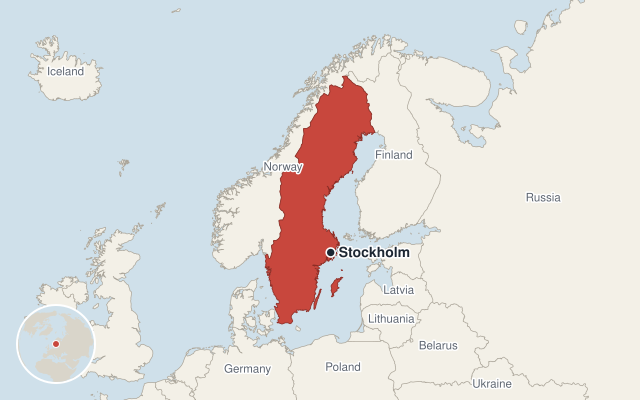

---
id    = "ca30612f-77a2-5995-89aa-19c90798ecb5"
model = "Basic"
tags  = ["europe", "european_union", "sovereign_state", "country"]
---

## Front

<b>Stockholm</b> is the capital of which country or territory?

## Back

<b>Sweden</b>

## Extra

About 10.6 million people (2025) in 450,295 km² Largest and most populous Nordic country

A unified Swedish state was established in the late 10th century. After joining the Thirty Years' War, Sweden formed an empire that controlled much of the Baltic Sea until the early 18th century.

<a href="https://en.wikipedia.org/wiki/Sweden">Sweden on Wikipedia</a> <a href="https://en.wikipedia.org/wiki/Stockholm">Stockholm on Wikipedia</a>
