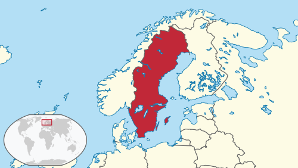
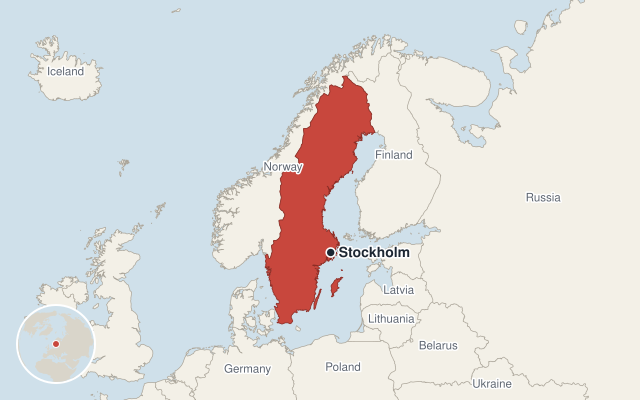

---
id    = "9af0f666-7873-5093-8b1b-187154bedb52"
model = "Basic"
tags  = ["europe", "european_union", "sovereign_state", "map"]
---

## Front

What is highlighted on this map?

## Back

<b>Sweden</b>

## Extra

<a href="https://en.wikipedia.org/wiki/Sweden">Sweden on Wikipedia</a>
