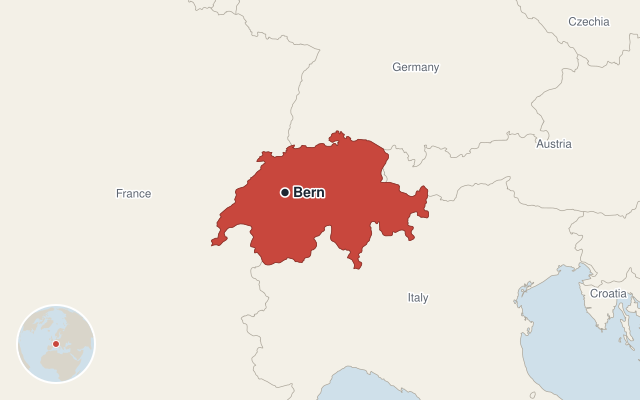

---
id    = "a09f2289-69cd-5a41-b9c8-89b1130fe414"
model = "Basic"
tags  = ["europe", "sovereign_state", "capital"]
---

## Front

What is the capital of <b>Switzerland</b>?

## Back

<b>Bern</b>

## Extra

<i>Photo: de:Benutzer:Reaast, Public domain, via Wikimedia Commons</i>

About 146,000 people (2024), the fifth most populous Swiss city 542 m up, surrounded by the Aare river

Officially the "federal city" and de facto capital. Legend says the city was named for the first animal its founder met on a hunt, a bear. Its old town became a UNESCO World Heritage Site in 1983.

Switzerland has no official capital; Bern is the de facto capital.

<a href="https://en.wikipedia.org/wiki/Bern">Bern on Wikipedia</a> <a href="https://en.wikipedia.org/wiki/Switzerland">Switzerland on Wikipedia</a>
