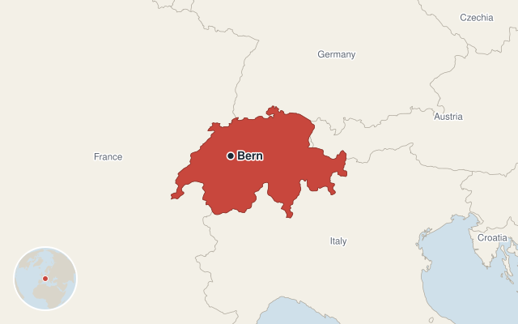

---
id    = "9e6204b6-1e28-5587-a939-fb75b5578a9f"
model = "Basic"
tags  = ["europe", "sovereign_state", "country"]
---

## Front

<b>Bern</b> is the capital of which country or territory?

## Back

<b>Switzerland</b>

## Extra

About 9.1 million people (2025) in 41,291 km² Four national languages: German, French, Italian and Romansh

The Federal Charter of 1291 is considered its founding document. Described as a Willensnation, a nation of volition, it is held together by federalism and direct democracy rather than language.

Switzerland has no official capital; Bern is the de facto capital.

<a href="https://en.wikipedia.org/wiki/Switzerland">Switzerland on Wikipedia</a> <a href="https://en.wikipedia.org/wiki/Bern">Bern on Wikipedia</a>
