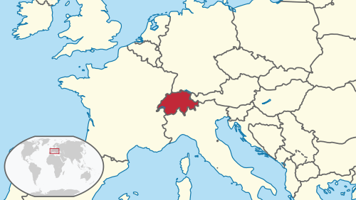
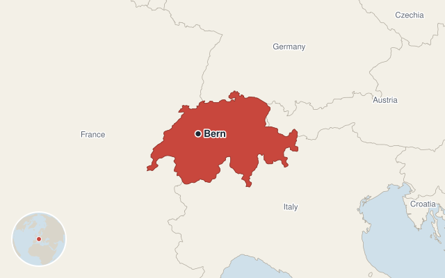

---
id    = "cd5c83b9-e573-5c4d-b301-e9acf5a5d28e"
model = "Basic"
tags  = ["europe", "sovereign_state", "map"]
---

## Front

What is highlighted on this map?

## Back

<b>Switzerland</b>

## Extra

Borders Germany, France, Italy, Austria and Liechtenstein Highest point: Dufourspitze

Landlocked. The Alps cover most of the territory, but most of the people live on the Swiss Plateau between the Alps and the Jura Mountains.

<a href="https://en.wikipedia.org/wiki/Switzerland">Switzerland on Wikipedia</a>
