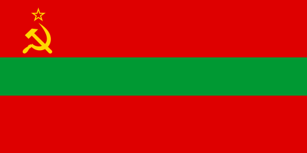

---
id    = "5116db25-14f4-5c22-b343-36393a3c390b"
model = "Basic"
tags  = ["europe", "sovereign_state", "flag"]
---

## Front

Whose flag is this?

## Back

<b>Transnistria</b>

## Extra

Adopted in 2000

A red, green and red triband with a gold hammer and sickle under a red star. It matches the flag of the Moldavian Soviet Socialist Republic, which Transnistria broke away from in 1990.

Independent state claimed by Moldova.

<a href="https://en.wikipedia.org/wiki/Flag_of_Transnistria">Flag of Transnistria on Wikipedia</a> <a href="https://en.wikipedia.org/wiki/Transnistria">Transnistria on Wikipedia</a>
