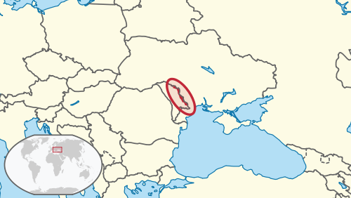

---
id    = "5888984e-fb2f-55fe-aa4a-2c28ab4543b7"
model = "Basic"
tags  = ["europe", "sovereign_state", "map"]
---

## Front

What is highlighted on this map?

## Back

<b>Transnistria</b>

## Extra

Independent state claimed by Moldova.
